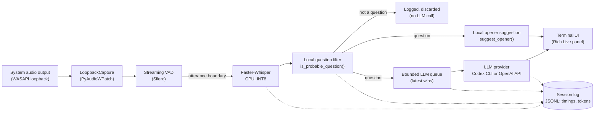

# ContextFlow AI — Real-Time Speech Intelligence System

A Python system that captures live system audio, transcribes it locally with a speech-recognition model,
detects which segments are questions or requests, and generates short, context-grounded suggestions using
an LLM — all with sub-10-second end-to-end latency on a CPU-only machine.

It was built as a personal engineering project to explore a full real-time speech → NLP → LLM pipeline:
streaming voice activity detection, local CPU transcription, a deterministic question classifier, bounded
concurrent queues, and two swappable LLM backends (Codex CLI and the OpenAI API).

> **Intended use & disclaimer.** This is a technical demonstration of a real-time conversational-AI
> pipeline (audio capture → ASR → NLP filtering → LLM → terminal UI), published as a portfolio project.
> It is **not** promoted, packaged, or intended as a tool to covertly receive hidden answers during job
> interviews. The same architecture applies to meeting assistance, training/coaching tools, conversation
> analytics, and any scenario where you want locally-grounded, low-latency suggestions over a live audio
> stream. All data in this repository (context document, transcripts, example questions) is fictional.

## Table of contents

1. [Description and objective](#description-and-objective)
2. [Implemented features](#implemented-features)
3. [Architecture and processing flow](#architecture-and-processing-flow)
4. [Tech stack](#tech-stack)
5. [System requirements and compatibility](#system-requirements-and-compatibility)
6. [Installation and setup](#installation-and-setup)
7. [Run commands](#run-commands)
8. [Example run (fictional data)](#example-run-fictional-data)
9. [Verified performance results](#verified-performance-results)
10. [Known limitations](#known-limitations)
11. [Possible future improvements](#possible-future-improvements)
12. [License](#license)

## Description and objective

ContextFlow AI listens to whatever audio a Windows machine is playing out of its speakers (not the
microphone), using WASAPI loopback capture. It segments that audio into utterances with a streaming voice
activity detector, transcribes each utterance locally with Faster-Whisper, decides — with a local,
deterministic heuristic, not an LLM call — whether the utterance contains a question or request, and, if
so, sends it to an LLM together with a user-supplied context document to produce a short, grounded answer.
Everything runs concurrently (capture, transcription and LLM calls are decoupled by bounded queues), and
every step is timed and logged to a local JSONL file for later analysis.

The goal of the project is to show a working, measured, end-to-end pipeline — not a chatbot wrapper. There
is no cloud service, no audio stored to disk, and no hidden network calls beyond the LLM provider you
configure.

## Implemented features

All of the following are implemented and have been exercised locally; nothing below is aspirational.

- **WASAPI loopback audio capture** via `PyAudioWPatch` — captures system audio output, not the microphone.
- **Streaming voice activity detection** with Silero VAD (bundled with `faster-whisper`), run frame-by-frame
  with persistent RNN state, pre-roll buffering, and a maximum-duration safety cutoff for very long utterances.
- **Local speech-to-text transcription** with Faster-Whisper, CPU-only, INT8 quantization.
- **Deterministic local question/request classifier** (`is_probable_question`) that runs before any LLM
  call, to avoid spending latency and tokens on non-questions.
- **Local "suggested opener" generator** (`suggest_opener`) — an instant, keyword-based first line to display
  while the real LLM answer is still being generated; it never fabricates facts or figures.
- **Codex CLI integration** (`codex exec`, read-only, ephemeral, no tool access) as the primary LLM backend,
  plus a drop-in OpenAI API backend behind the same interface.
- **Context-grounded answer generation**: every LLM call is instructed to use only the supplied context
  document and to say so explicitly when the context doesn't cover the question.
- **Concurrent processing with bounded, latest-wins queues**: audio capture, transcription and LLM calls run
  on separate threads; if a new utterance arrives while an LLM call is in flight, the older one is dropped
  and logged, so the UI never falls behind.
- **Rich terminal UI** with a live-updating panel (state indicator, current question, up to three answer
  bullets, suggested opener while waiting).
- **Pause and clean shutdown controls** — `P` pauses/resumes capture-to-LLM processing without closing the
  audio stream; `Ctrl+C` cancels any in-flight LLM call, kills its child process tree, stops capture cleanly,
  and prints a session summary.
- **Diagnostic logging and latency measurement**: every utterance is logged as JSON (transcript, timings per
  stage, token counts, classification outcome) to `logs/sesion-<timestamp>.jsonl`; `benchmark.py` runs a
  fixed question set against every configured model/tier and reports latency statistics.

## Architecture and processing flow



Each utterance flows through the pipeline independently; the question filter and opener run with no
network call, so the UI can show *something* within milliseconds even while the real LLM answer (the slow
step) is still being generated.

## Tech stack

| Layer | Technology |
|---|---|
| Language | Python 3.11+ |
| Audio capture | PyAudioWPatch (WASAPI loopback) |
| Voice activity detection | Silero VAD (via `faster-whisper.vad`) |
| Speech-to-text | Faster-Whisper (CTranslate2), CPU, INT8 |
| LLM backends | Codex CLI (`codex exec`, JSON event stream) and OpenAI API (`responses.create`) |
| Terminal UI | Rich (`Live`, `Panel`, `Table`) |
| Config | `python-dotenv` (`.env`) |
| Numerics | NumPy |

## System requirements and compatibility

ContextFlow AI was built and tested on **Windows only**. The sections below separate what is a verified
platform limitation from what is just a configuration or performance detail you can adjust for your own
machine — this project does not claim compatibility it hasn't actually checked.

### Baseline requirements

- **OS: Windows 10 or 11.** The audio capture layer (`PyAudioWPatch`, WASAPI loopback) is a Windows-only
  API. This is a verified incompatibility with macOS/Linux, not a configuration gap — running there would
  require swapping in a different audio backend (see [Possible future improvements](#possible-future-improvements)),
  not just changing settings.
- **Terminal UI, not a standalone GUI app.** The interface is a Rich-based live panel rendered inside
  whatever terminal runs `main.py --assistant`; there is no separate windowed application. Any terminal with
  ANSI/Unicode support works (Windows Terminal recommended); a plain legacy `cmd.exe` console may render
  accents or the live panel imperfectly — a terminal-capability detail, not a pipeline bug (see the
  accented-character note above).
- **Python 3.11 or later.**
- **CPU-only by design, not by limitation.** Faster-Whisper runs with INT8 quantization on CPU; no GPU is
  required or used anywhere in the pipeline.
- **A working, correctly detected audio output device.** `LoopbackCapture` derives the loopback device from
  your current **default output device** (speakers/headphones), not the microphone. If Windows has no
  default output device, or it changes while the app is running, capture will fail to start or silently
  capture nothing — this is a device-configuration issue, not a code defect.
- **Codex CLI, installed and authenticated (`codex login`)**, is required to use the default LLM provider;
  the alternative is a funded **OpenAI API key** with `LLM_PROVIDER=openai`. Neither is bundled — both are
  external prerequisites you set up yourself, and the project cannot verify your account's model catalog or
  credits on your behalf.

### Checking and adapting requirements on a different machine

1. Confirm the OS is Windows 10/11 — this one is a hard requirement, not something `.env` can work around.
2. Run `python audio.py` to confirm a WASAPI loopback device is detected for the current default output
   device. If none is found, change the default output device in Windows sound settings and re-run.
3. Run `python main.py --check` — it loads the Whisper model and opens/closes the audio device without
   calling any LLM. A clean "Comprobación OK" confirms the local half of the pipeline (audio + VAD +
   transcription) works on that machine, independent of any LLM configuration.
4. Pick `LLM_PROVIDER` (`codex` or `openai`) based on what you actually have authenticated or funded, and
   fill in `.env` accordingly — see `.env.example`; it ships with provider/model fields intentionally blank
   for you to fill in, not pre-set to any particular account's choices.
5. If answers feel slow, that is almost always the LLM round trip (see
   [Verified performance results](#verified-performance-results)), not local processing — check
   `CODEX_TIMEOUT_SECONDS` / `CODEX_SERVICE_TIER` or your network before assuming something is broken.

### Configuration vs. performance vs. real incompatibility

This project tries not to conflate these three, and neither should you when adapting it:

- **Configuration** (expected, no code changes needed): default output device, `.env` values (provider,
  model slug, VAD thresholds, Whisper language), which Whisper model size you load (`--model base`,
  `small`, `medium`, …).
- **Performance** (expected to vary with hardware, no code changes needed): end-to-end latency and
  transcription speed scale with CPU speed, available RAM, the Whisper model size chosen, and LLM/network
  load. A slower machine is still fully functional — just slower. A different, faster or slower CPU does
  **not** require modifying the code.
- **Real incompatibility** (would require actual code changes, not configuration): no WASAPI-loopback
  equivalent wired in for macOS/Linux, and the keyboard-based pause control (`msvcrt`) has no effect outside
  Windows.

Outside of what's listed above as verified, treat compatibility as **unverified** — this README does not
claim it works on Linux, macOS, or an unverified hardware/driver combination, because that hasn't been
tested.

## Installation and setup

```powershell
git clone <this-repo-url> contextflow-ai
cd contextflow-ai

python -m venv .venv
.\.venv\Scripts\python.exe -m pip install -r requirements.txt

Copy-Item .env.example .env
Copy-Item context.example.md context.md   # replace with your own context document for real use
```

`context.md` and `.env` are both git-ignored — they are meant to hold your own material and are never
committed. `context.example.md` is the fictional stand-in shipped in this repo.

## Run commands

```powershell
# Full assistant: interactive model menu, live panel, Codex/OpenAI answers
.\.venv\Scripts\python.exe .\main.py --assistant

# Same, with technical/debug output instead of the live panel
.\.venv\Scripts\python.exe .\main.py --assistant --debug

# Test the LLM step with a single text, no audio
.\.venv\Scripts\python.exe .\main.py --ask "What tools would you use to track deliveries?"

# Sanity check: open the audio device and load the Whisper model, then exit
.\.venv\Scripts\python.exe .\main.py --check

# List WASAPI devices and the detected loopback device
.\.venv\Scripts\python.exe .\audio.py

# Compare configured model options on a fixed question set (no audio)
.\.venv\Scripts\python.exe .\benchmark.py --rondas 2

# Offline, no-LLM demo of the full pipeline (see next section)
.\.venv\Scripts\python.exe .\demo.py
```

| Key | Action |
|---|---|
| `P` | Pause/resume. While paused, capture keeps running but nothing is transcribed or sent to the LLM. |
| `Ctrl+C` | Clean shutdown: stops capture, cancels any in-flight LLM call, kills its child processes, prints a session summary. |

## Example run (fictional data)

`demo.py` reproduces the entire pipeline — question filtering, local opener suggestion, and answer display —
**without a microphone and without calling any real LLM**. A local `DemoProvider` stands in for Codex CLI /
OpenAI and returns a fixed, clearly-labeled simulated answer, so the demo is safe to run with no credentials
and no audio hardware assumptions:

```powershell
.\.venv\Scripts\python.exe .\demo.py
```

Abridged output (translated; the actual demo runs with Spanish example utterances, matching the local
question-filter heuristics):

```
ContextFlow AI — local demo
Fictional script, no audio, no real LLM calls. Pipeline walkthrough only.

Utterance #1: "To start, tell me a bit about yourself and your experience."
-> suggested opener (local, no LLM): "I'll give you a short summary of my background."
- [DEMO] This is a simulated answer; no language model was called.
- [DEMO] In the real assistant, this bullet would be generated from context.md and the real transcript.
latency: 0.40s (simulated, not representative of the real LLM)

Utterance #2: "Thank you so much for your time today."
-> filtered locally (no question signal found); not sent to the generation step.

Utterance #3: "What tools would you use to track shipments in a distribution center?"
-> suggested opener (local, no LLM): "I'd first look at what's happening in the operation and what
   constraints are involved."
...
```

For a real run with a real LLM, use `--assistant` (Codex CLI, authenticated) or `--ask "..."` with
`LLM_PROVIDER=openai` and a valid `OPENAI_API_KEY`.

> **Note on accented characters.** If accented characters render incorrectly in a Windows console (seen
> during testing with the default `cmd.exe`/PowerShell codepage), run with
> `$env:PYTHONIOENCODING="utf-8"` first, or use Windows Terminal.

## Verified performance results

These numbers come from internal benchmark/simulation runs on the author's development machine (CPU-only,
Faster-Whisper `base`, INT8), not from production traffic or a controlled lab environment — treat them as
indicative, not as a performance guarantee:

- **End-to-end latency** (voice end → answer displayed, standard Codex tier): **≈ 7.11 s average** across a
  scripted multi-question simulation covering the full pipeline (transcription → local filter → Codex CLI
  round trip → display).
- Latency is dominated by the LLM call itself (Codex CLI round trip), not by local transcription or VAD,
  which together typically add well under 1 second per utterance.
- The "Fast" / `priority` service tier (where available on the Codex account used) measurably reduces LLM
  latency versus the standard tier; the exact improvement depends on account-level catalog availability and
  is not something this project controls.
- Local steps (question filter, opener suggestion) are effectively instantaneous (single-digit milliseconds)
  since they involve no network or model call.

Actual latency will vary with: the LLM model/tier selected, Codex/OpenAI load and network conditions, CPU
speed, and the length of the context document sent with every call. Run `benchmark.py` yourself to get
numbers for your own machine and account.

## Known limitations

- **Windows-only.** WASAPI loopback capture (`PyAudioWPatch`) has no equivalent in this codebase for macOS
  or Linux.
- **Requires an authenticated LLM backend.** The default Codex CLI provider needs a logged-in Codex CLI
  (ChatGPT account); the alternative needs a funded OpenAI API key. There is no offline/local LLM option.
- **Latency is not real-time in the sub-second sense.** End-to-end answer latency is typically several
  seconds (see above), dominated by the remote LLM call; this is not suitable for use cases requiring
  instant responses.
- **The question/request filter is a heuristic**, not a model. It is deliberately conservative (favors
  false positives over false negatives) but can still misclassify unusual phrasings, especially outside the
  Spanish-first keyword set it was tuned on.
- **Loopback capture records what the speakers play, not the microphone**, and does not distinguish between
  speakers in a multi-party conversation — it treats all output audio as one undifferentiated stream.
- **The context document is static and manually maintained.** There is no live sync from an external source
  (e.g. a wiki or notes app) in this public version — you edit `context.md` by hand.
- **No conversation memory.** Each utterance is answered independently; the LLM does not see prior turns in
  the session.
- **The "suggested opener" and filter keyword lists are tuned for Spanish** (with partial English coverage
  in the question-start patterns); answers themselves follow the detected language of the transcript.
- **The demo mode's answers are fabricated placeholders**, not real model output — it exists to exercise the
  pipeline mechanics safely, not to showcase answer quality.

## Possible future improvements

These are explicitly out of scope for this version and are left as future work:

- Pluggable context sources beyond a static Markdown file (e.g. structured documents, multiple files).
- A lightweight web or desktop UI as an alternative to the terminal panel.
- Speaker diarization, to distinguish multiple voices in the captured audio.
- A broader, automated evaluation harness (beyond the manual `benchmark.py` script) with regression tracking.
- Additional ASR backends or model sizes, selectable at runtime.
- Cross-platform audio capture (e.g. a PulseAudio/CoreAudio backend) for macOS/Linux support.
- Retrieval-augmented context (RAG) or a vector store for larger knowledge bases — intentionally **not**
  implemented here; this version keeps the context model simple and fully local.

## License

MIT — see [LICENSE](LICENSE).
